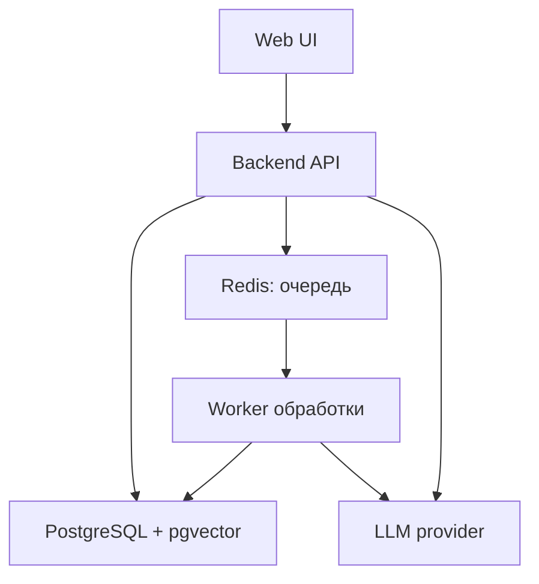

# Проект: комплексное исследование книг

Версия 0.3 · 1 ноября 2026 · Требования, архитектура и рабочий процесс

## 1. Замысел

Личное исследовательское пространство, в котором книга превращается в связанную базу материала: исходный текст, сцены, события, персонажи, отношения, предметы, мотивы, символы и интерпретации. На этой основе читатель исследует собственный вопрос и при желании связывает выводы со своей жизнью.

Система должна помогать возвращаться от любой гипотезы к конкретным эпизодам. Задача — поддерживать исследование, а не выдавать единственную трактовку или заранее искать мораль произведения.

## 2. Уровни разбора

| Уровень | Содержание | Результат |
| --- | --- | --- |
| Текстовый | Полный текст, главы, абзацы, прямые цитаты, реплики | Проверяемая основа исследования |
| Сюжетный | Сцены, события, решения, последствия, поворотные моменты | Карта того, что происходит и почему |
| Персонажный | Цели, мотивы, страхи, ценности, противоречия, поступки | Портрет и динамика каждого героя |
| Отношений | Конфликты, союзы, зависимость, власть, доверие, изменение отношений | Карта взаимодействий |
| Символический | Значимые предметы, повторяющиеся образы, мотивы, противопоставления | Связанные варианты прочтения |
| Личного исследования | Вопрос читателя, подтверждения, возражения, выводы, возможное применение | Исследовательская заметка с опорой на книгу |

Архетипические, мифологические и эзотерические прочтения допустимы как отдельно обозначенные интерпретационные рамки. Связи внутри текста нужно отличать от внешних ассоциаций исследователя.

## 3. Основные сущности

### Книга и исходный текст

Автор, произведение, язык, перевод, издание и версия текста. Для романа возможна иерархия: книга → часть → глава → сцена → фрагмент; структура зависит от типа произведения. Сцена может быть выделена системой или читателем и должна сохранять границы исходного текста. Событие не равно сцене: одна сцена может содержать несколько событий.

### Событие

Что произошло; участники; место; положение в тексте; время внутри истории, если оно известно; предпосылки; выбор; последствия; значимые предметы; ссылки на текст. Отдельно — порядок рассказа и хронология событий. Причинная связь и простое следование во времени должны различаться.

### Персонаж

Имена и прозвища, роль в истории, исходное положение, заявленные и предполагаемые цели, потребности, страхи, ценности, ресурсы, внутренний конфликт, отношения. Слова героя, мнение рассказчика, мнение других персонажей и вывод исследователя хранятся раздельно.

Портрет меняется по мере сюжета. Для предполагаемого изменения: состояние до → событие или решение → состояние после → текстовые основания. Система допускает отсутствие изменения, временное колебание и раскрытие черты, которая существовала раньше. Психологическая характеристика — интерпретация поведения, а не клинический диагноз.

### Отношение и конфликт

Участники, предмет конфликта, цели сторон, несовместимость интересов или ценностей, способы взаимодействия, распределение власти и зависимости, развитие по эпизодам. Возможны открытые и скрытые конфликты, союзы, предательство и смена ролей.

### Предмет, образ, мотив и символ

Нужно различать предмет в мире истории, его сюжетную функцию, повторяющийся мотив и символическую трактовку. Карточка содержит появления, владельцев и передачи, действия вокруг предмета, последствия, связанные образы и гипотезы значения. Значимость не определяется одной частотой упоминания.

### Вопрос, гипотеза и вывод

Формулировка читателя, уточнения, найденные фрагменты, несколько объяснений, подтверждения, противоречия, открытые вопросы и текущий вывод. У интерпретации должны быть авторство, основания и статус: предположение, поддержанная версия, спорная версия или отклонённая версия. Числовая уверенность сама по себе не заменяет доказательств.

## 4. Субъектно-объектные матрицы

Предварительное рабочее определение, которое ещё нужно уточнить с пользователем: кто действует, на кого или на что направлено действие, чего субъект добивается, каким способом, какова реакция и результат.

Колонки: субъект → объект действия → цель → действие/способ → реакция → результат → сцена/цитата. Объектом может быть человек, предмет, положение или идея. Один персонаж может быть субъектом в одном взаимодействии и объектом чужого воздействия в другом; это не постоянный ярлык личности.

Дополнительное представление: персонажи × персонажи с направленными отношениями и фильтром по этапу сюжета. Нужно уточнить, подразумевается ли также отдельная психологическая или философская методика субъектно-объектного анализа.

## 5. Поиск и навигация

- Точный поиск слов и цитат; поиск по смыслу и вопросу; фильтры по персонажу, событию, предмету, отношению, главе и типу интерпретации.
- Переход от результата к исходному фрагменту с соседним контекстом.
- Навигация по типизированным связям: участвует, владеет, передаёт, конфликтует, предшествует, предположительно вызывает, подтверждает, противоречит, интерпретируется как.
- Три взаимодополняющих представления: лента событий, карточки сущностей и граф связей.
- Граф показывает только выбранное окружение и позволяет отличать текстовые связи от интерпретационных.
- Поиск допускает результат «в тексте не найдено» и запрос уточнения, если вопрос неоднозначен.

## 6. Предварительные технические требования

1. Сохранять исходный текст и его версию. Кэшировать результаты обработки отдельно от первоисточника; повторное исследование не должно требовать нового разбора всей книги.
2. Использовать устойчивые идентификаторы книги, фрагментов и сущностей; ссылки на главу и диапазон абзацев или символов. Номера страниц использовать только для издания, где они доступны.
3. Сочетать полнотекстовый индекс, смысловой поиск и структурированные связи. Конкретная база данных и необходимость отдельной графовой СУБД пока не выбраны.
4. При разбиении текста на поисковые фрагменты сохранять контекст и привязку к сценам; размер фрагмента не должен подменять художественную структуру книги.
5. Сохранять историю правок, авторство разметки и версию автоматического анализа. Пользователь может исправлять, объединять и разделять сущности, подтверждать или отвергать связи.
6. Пересчитывать зависимые результаты при исправлениях; не оставлять устаревшие выводы без пометки.
7. Дословные цитаты извлекать из исходника, проверять совпадение и обозначать пропуски; пересказы не выдавать за цитаты.
8. Предусмотреть экспорт заметок, разметки и связей. Форматы импорта и экспорта, размещение, стоимость обработки и режим приватности ещё не определены.

## 7. Исследовательский сценарий: «Остров сокровищ»

Вопрос читателя: «Что делает опасное приключение привлекательным для мужчин, у которых есть устроенная жизнь, и какие элементы этого опыта можно включить в современную городскую жизнь?»

Это исходный вопрос, а не установленное объяснение книги. Предпосылки «у всех всё было», «всем не нужны были деньги» и «все отправились по одной причине» проверяются отдельно для каждого героя.

Ход работы:

1. Найти исходное положение и эпизоды принятия решения для каждого участника.
2. Сопоставить мотивы, обещанные выгоды, известные риски и альтернативы на момент выбора. Не подменять доступные герою сведения знанием финала.
3. Проследить последствия, потери и изменения каждого персонажа.
4. Исследовать сюжетную роль карты и сокровища; предложить символические прочтения с основаниями и возражениями.
5. Сформулировать несколько объяснений привлекательности приключения и оценить, какое лучше поддерживается материалом.
6. Отдельно построить мост к жизни читателя: какой элемент опыта ему нужен и какое современное действие могло бы его воплотить. Это личная гипотеза и эксперимент, а не доказанный книгой рецепт.

## 8. Предлагаемые критерии приёмки

- Из карточки события можно открыть точный фрагмент книги и контекст, соблюдая выбранную границу чтения.
- По герою можно увидеть его ключевые решения и основания предполагаемого изменения.
- По предмету можно восстановить его появления, передачи и связанные события в пределах размеченного текста.
- По конфликту видны цели обеих сторон и изменение отношений.
- Любая содержательная интерпретация снабжена основаниями либо явно отмечена как неподтверждённая.
- Противоречащие эпизоды сохраняются рядом с подтверждающими; допускаются конкурирующие трактовки.
- Матрица и граф позволяют переходить к карточкам и исходнику.
- Правка сущности сохраняется и отражается в зависимых представлениях.
- На личный вопрос получается исследовательское досье: версии, свидетельства, возражения, вывод и оставшиеся вопросы.
- Для проверки качества поиска используется небольшой набор пользовательских запросов с вручную выбранными ожидаемыми эпизодами; требуемые показатели полноты и точности ещё предстоит согласовать.

## 9. Границы текущего этапа

Сейчас фиксируются замысел, требования и рекомендуемый технологический контур. Разработка и полный анализ книги ещё не выполняются; конкретные версии зависимостей и окончательный стек предстоит проверить при реализации. Возможный первый объём — одна книга, исходный текст, события, персонажи, предметы, связи и исследование одного вопроса. Это предложение, а не согласованное ограничение. Система задумана для личной работы, без общего доступа; предполагаемые форматы исходника — PDF, EPUB и текст. Приложение запускается локально через Docker; публикация и облачное развёртывание пока не планируются.

Для последующих уточнений остаются: детали интерфейса и локального окружения; используемые психологические модели; точное значение субъектно-объектной матрицы; глубина символического анализа; детали спойлеров и внешних источников; сравнение книг; критерии качества и бюджет.

## 10. Уточнение концепции: карта, которая раскрывается при чтении

Книга автоматически обрабатывается целиком. На её основе строится связанная карта текста, событий, персонажей, отношений, предметов и других элементов. Читатель выбирает, открыть ли ему полный разбор сразу или постепенно раскрывать его по мере чтения. Глубину просмотра пользователь также выбирает сам. Анализ помогает ориентироваться и исследовать свои вопросы; готовые выводы и личные ответы не навязываются.

### Как человек работает с книгой

1. Загружает PDF, EPUB или текст. Система извлекает текст и структуру, затем автоматически подготавливает карту всей книги.
2. Может открыть общий обзор книги и внешний контекст: кто и когда написал, обстоятельства создания и связанные материалы при наличии проверяемых источников. Обзор и сведения о сюжете должны учитывать выбранный режим спойлеров.
3. Отмечает, например, что прочитал первую главу, и открывает её краткий обзор: что произошло, кто участвовал, ключевые события и общая схема связей.
4. По желанию углубляется в персонажей, предметы, эпизоды и другие уровни анализа. Можно остановиться на обзоре или вернуться к материалу позже.
5. При желании создаёт отдельную личную заметку к главе: впечатления, вопросы и мнения. Заполнение необязательно, пользователь может вести свои записи и вне системы.
6. Задаёт вопрос и получает релевантный материал с переходами к тексту и связанным элементам; может исследовать несколько возможных связей и интерпретаций. Если данных недостаточно, неясность остаётся открытой.

### Доступ к материалу и спойлеры

- Режим полного раскрытия даёт доступ к анализу всей книги по выбору читателя.
- Режим постепенного раскрытия ограничивает обычный обзор и ответы выбранной прочитанной частью. Данные о будущих событиях, изменениях персонажей, значениях предметов и их дальнейших связях не должны раскрываться через граф, карточки, поиск, подсказки, внешний обзор или личные исследования.
- Факт, что материал заранее обработан, не означает согласия показывать результаты за пределами прогресса. Особый доступ к будущим сведениям возможен по выбору читателя; способ предупреждения и настройки границы ещё уточнить.
- Общий обзор книги и внешний контекст должны иметь вариант без сюжетных раскрытий; если внешний материал содержит спойлеры, он требует отдельной пометки.

### Предметы и значимость

- Система старается автоматически распознавать упомянутые предметы и хранить их в каталоге вместе с текстовыми основаниями и появлениями. Полнота распознавания не предполагается абсолютной.
- Автоматически предлагаются ключевые моменты и объекты по сюжетной значимости и значимости для конкретного героя. Оба вида значимости показываются отдельно; значимость может меняться по ходу сюжета. Предложение — оценка системы с основаниями, а не безошибочный факт.
- Читатель может выбрать предмет из каталога и добавить его в свою рабочую структуру, либо ввести его сам. Система предлагает соответствующее название или существующую запись; пользователь подтверждает, исправляет или создаёт новую.
- Пользователь может считать важным объект, который система не выделила, например личный сундучок героя. Автоматическая и личная значимость сохраняются раздельно. В режиме без спойлеров показываются только доступные на текущей границе появления и основания.

### Личные заметки

Заметки — отдельная личная категория, привязанная прежде всего к книге или главе; это не обязательные аннотации на полях исходного текста. Можно сохранять впечатления, вопросы и мнения, возвращаться и редактировать. Дополнительные связи с персонажами, сценами и предметами можно предусмотреть по желанию читателя. Личные записи не должны автоматически становиться утверждениями о книге.

## 11. Модульный подход и дополнения к методике

Общая основа включает исходный материал, структуру, привязки к фрагментам, поиск, связи, заметки и вопросы. Аналитические модули выбираются в зависимости от произведения и интересов читателя. Они применяются там, где имеют смысл, без требования насильно заполнять все категории.

- **Повествование:** рассказчик, точка зрения, доступность знания, ограничения и возможная ненадёжность рассказа; различие событий и способов их подачи.
- **Язык и форма:** метафоры, повторы, тон, ритм, особенности речи, диалоги, умолчания и композиция.
- **Пространство, время и устройство мира:** функции мест, переходы, правила и общественные роли; порядок рассказа и событий, длительность и темп.
- **Темы и противоречия:** сквозные вопросы и противопоставления, их проявления в сценах и развитие в книге, в том числе без однозначного ответа.
- **Читательский опыт:** личные эмоциональные реакции, смена отношения и ассоциации, сохранённые по желанию в личных заметках. Реакция читателя не выдаётся за намерение автора или состояние персонажа.
- **Интерпретационные подходы:** психологический, социальный, философский, исторический, формальный, символический, мифологический и личный; эзотерические ассоциации возможны с указанием традиции или личного происхождения. У каждого прочтения указываются основания и возможные возражения.
- **Внешний контекст:** автор, создание произведения, исторические обстоятельства и связанные материалы с указанием источников. Сведения из текста, внешнего источника и интерпретации различаются; связь с биографией автора не принимается автоматически.
- **Тип произведения:** для романа подходят сцены и события, для пьесы — акты, реплики и ремарки, для стихотворения — строки, строфы, образы и ритм, для философского текста — тезисы и аргументы. Поддержку конкретных типов и форматов реализации предстоит определить; произведения других медиа потребуют расширений.

## 12. Дополнительные критерии для проверки

- После загрузки поддерживаемого формата доступен результат обработки; качество извлечённого текста и границы глав можно проверить и исправить. Сканированный PDF может требовать распознавания текста; качество зависит от исходника.
- В режиме по мере чтения обзор главы, граф, карточки, поиск, подсказки и ответы не раскрывают информацию за отмеченной границей. По явному выбору доступен полный разбор.
- Общий обзор книги доступен в варианте без спойлеров; исторические и биографические сведения имеют источники либо помечены как непроверенные.
- Можно открыть общий обзор главы и затем по собственному выбору углубиться в её участников, события и связи.
- Система предлагает предполагаемую значимость для сюжета и героя с привязкой к материалу и позволяет читателю назначить собственную.
- Можно найти распознанный предмет, добавить его в личную структуру или создать вручную с возможностью принять или отклонить предложенное совпадение.
- Можно создать отдельную заметку к главе; отсутствие заметки не мешает исследованию.
- На вопрос показываются относящиеся к нему материалы и возможные интерпретации; недостаточность оснований явно обозначается, готовый личный вывод не навязывается.
- Для разных типов произведений применяются подходящие единицы и модули; несуществующие сцены, герои или сюжетные изменения не выдумываются.

## 13. Рекомендуемая архитектура

Статус: предложение для реализации, а не уже построенная система. Целевой режим — личное приложение с локальным развёртыванием через Docker Compose. Веб-интерфейс взаимодействует с серверным ядром; ядро отправляет необходимые фрагменты внешнему LLM API или другому настроенному провайдеру. Публичный деплой пока не планируется.

### Архитектурный шаблон

**Модульный монолит + фоновые задачи + последовательный конвейер анализа + адаптеры LLM.** Предметная логика разделена по модулям внутри одного backend-проекта. API и worker запускаются отдельными процессами; развёртываются вместе. Не требуется заранее выделять каждый модуль в отдельный сервис.



Оригиналы файлов и резервные копии находятся в постоянном файловом хранилище; схема не показывает все соединения. Приложение локальное, но выбранный внешний API, Context7 и внешние источники требуют сети и имеют собственные правила обработки данных.

### Технологический каркас

| Участок | Рекомендуемый выбор | Роль |
| --- | --- | --- |
| Frontend | React + TypeScript + Vite | Экраны библиотеки, книги, главы, поиска и исследований |
| Граф | React Flow, проверить на прототипе | Навигация по персонажам, событиям и предметам |
| API и core | Python + FastAPI | Пользовательский API и предметная логика |
| Схемы и данные | Pydantic, SQLAlchemy, Alembic | Проверка структур, работа с БД и миграции |
| Фоновые задачи | Celery + Redis | Очередь и выполнение длительных этапов |
| База | PostgreSQL + pgvector | Структуры, связи, источники, полнотекстовый и векторный поиск |
| Файлы | Постоянный Docker volume на старте | Исходники и результаты извлечения; резервное копирование |
| LLM | OpenAI Responses API через собственный адаптер | Извлечение структур, исследования и ответы |
| Запуск | Docker Compose | API, UI, worker, Postgres, Redis |
| CI | GitHub Actions при размещении кода в GitHub | Проверки, тесты и сборка; выбор репозитория остаётся открытым |

Версии библиотек, ОС и целевой сервер не зафиксированы. Выбор компонентов проверяется в прототипе. CI означает автоматические проверки и сборку; UI — пользовательский интерфейс.

### Модули ядра

`library` — книги и издания; `ingestion` — импорт и извлечение; `analysis` — конвейер; `characters`, `events`, `objects`, `relations`, `narrative` — отдельные элементы разбора; `research` — вопросы и гипотезы; `reader` — прогресс и личные заметки; `search` — поиск; `llm` — контракт и адаптеры провайдеров. Названия — ориентир для проектирования, не окончательная файловая структура.

## 14. Обработка книги и поиск

### Конвейер

1. Получить PDF, EPUB или текстовый файл; сохранить оригинал и версию.
2. Извлечь текст, главы и положения фрагментов; при необходимости предусмотреть OCR для сканов и проверку качества извлечения.
3. Разбить материал для обработки и поиска, сохраняя границы источника и доступный контекст.
4. Обработать всю книгу: извлечь кандидатов в персонажи, события, предметы, связи и основания; сформировать базовую карту и обзоры.
5. Сопоставить упоминания и имена между главами. Сомнительные объединения сохранять как предложения, доступные для исправления.
6. Построить аналитические представления и индексы; отобразить статус и ошибки отдельных этапов.
7. Дополнительный глубокий анализ по отдельным модулям может выполняться по запросу, если это позволяет контролировать стоимость, не отменяя автоматическую подготовку базовой карты всей книги.

Хранить результаты этапов и версии промптов, моделей и входного текста. Повторный запуск отдельного этапа не должен повторно создавать одни и те же записи или затирать пользовательские заметки и правки. Предусмотреть статусы, таймауты, ограниченные повторы и возможность продолжения после ошибки; параметры очереди проверять на практике.

### Поиск и источники

Гибридный поиск сочетает точный поиск цитаты, полнотекстовый поиск, векторный поиск и обход структурированных связей. Подход к поиску русскоязычных текстов и качество векторного поиска проверяются на тестовом наборе. Отдельная графовая СУБД не требуется для первого прототипа: сущности и связи можно хранить в таблицах PostgreSQL, а граф строить в интерфейсе. Возможность перехода к отдельной графовой БД оставить открытой.

У каждого содержательного утверждения фиксировать автора или источник, тип, опорные фрагменты и версию анализа. Цитаты извлекать из проверенного текста, а не доверять их посимвольное воспроизведение модели. Неизвестное и конкурирующие трактовки сохранять явно. Внешний исторический контекст должен иметь собственные источники и не смешиваться с текстом книги.

## 15. LLM и защита от спойлеров

### LLM-слой

Использовать отдельный внутренний интерфейс провайдера с операциями структурированного извлечения, ответа с контекстом и создания эмбеддингов. Первоначальный адаптер — OpenAI API; замена провайдера требует проверки совместимости структурированного вывода, контекста, эмбеддингов и потоковых ответов.

Использовать структурированный ответ по схеме для извлечения сущностей и их связей. Валидный JSON сам по себе не гарантирует достоверности: ссылки и форматы проверяются кодом, трактовки сверяются с источником и доступны для исправления. Для ответов на вопросы сначала отбирать релевантные фрагменты и связи, затем передавать их модели с ограничением по прогрессу.

Кандидаты для пробного сравнения: GPT-6 Luna для массового извлечения, GPT-6.1 Sol для сложного анализа, GPT-6 Astra для наиболее сложных вопросов, text-embedding-3-small для начальной проверки поиска. Это стартовые гипотезы по состоянию на ноябрь 2026 года, не обещание качества или закреплённые зависимости. Сравнивать на русскоязычных фрагментах, качестве ссылок, устойчивости к спойлерам, времени и стоимости. Проверять актуальную доступность моделей и цены перед использованием. Для пакетной обработки оценить Batch API и задержку; интерактивные запросы обрабатывать отдельно.

API-ключ хранить только на серверной стороне; не включать его в исходный код, логи или UI. Для тестов использовать подставного провайдера; реальные запросы выделить в отдельные интеграционные проверки. Внешний LLM получает отправленные ему фрагменты: проверять настройки хранения и условия конкретного провайдера. Личные заметки передавать только когда они нужны для запрошенного исследования.

### Граница чтения

Поскольку вся книга обрабатывается заранее, скрытие глав только в интерфейсе недостаточно. Карточки, обзоры и связи, составленные по всей книге, могут содержать сведения из будущих глав.

- В режиме постепенного чтения на сервере отбирать только источники и утверждения, допустимые до выбранной позиции; применять правило к API, поиску, карточкам, графу, подсказкам и материалу, переданному LLM.
- Карточки строить по состоянию на границу чтения. Выводы, смешивающие ранние и поздние сведения, пересоздавать из доступных данных либо скрывать.
- Учитывать утечку через названия, факт существования связи, её изменение и источники; тестировать переходы и меняющиеся границы.
- Модель может знать сюжет из обучения. Инструкции ограничивать ответ доступными источниками, проверять тестовыми сценариями; не обещать абсолютную защиту только за счёт промпта.

## 16. Дизайн интерфейса до разработки

Цель — сначала согласовать продуктовый интерфейс, а затем реализовывать приложение в соответствии с ним. Макет может уточняться до утверждения.

1. Описать основные сценарии: библиотека, карточка книги и прогресс, обзор главы, персонаж, граф, вопрос к книге и личные заметки. Для каждого указать основные состояния: загрузка, пустой результат, ошибка, ограничение спойлеров, готовый анализ.
2. С помощью AI подготовить визуальные концепции ключевых экранов. Читатель рассматривает и корректирует варианты до утверждения.
3. Создать локальный интерактивный прототип с демонстрационными данными и основными переходами. Картинка сама по себе не является редактируемым интерактивным прототипом.
4. Зафиксировать утверждённые экраны, пользовательские действия, состояния, размеры и адаптацию к устройствам в `docs/ui-spec.md` и эталонных материалах.
5. Только после утверждения передать макет в реализацию; заменять демонстрационные данные реальными и сверять работающие экраны и поведение с макетом.

Первичный вариант инструмента — Build Web Apps, навык `frontend-app-builder` в режиме рассмотрения концепции. Product Design подходит для более глубокого исследования UX; Figma — если понадобится редактировать макеты в Figma и использовать соответствующую интеграцию. Приложение и прототип предназначены для локального запуска, а не для публикации.

## 17. Codex plugins, Skills и MCP

Подборка от 1 ноября 2026 года; наличие зависит от версии Codex, каталога и способа входа. Ничего на локальном компьютере ещё не установлено. Plugin — пакет, который может включать Skills и MCP; Skill остаётся отдельной переиспользуемой инструкцией. Репозиторий `openai/skills` помечен устаревшим; актуальные примеры OpenAI: https://github.com/openai/plugins.

| Инструмент | Рекомендуемое применение | Приоритет |
| --- | --- | --- |
| [Build Web Apps](https://github.com/openai/plugins/tree/main/plugins/build-web-apps) | `frontend-app-builder`, frontend QA, React, рекомендации PostgreSQL | Основной |
| [OpenAI Developers](https://github.com/openai/plugins/tree/main/plugins/openai-developers) | OpenAI API, документация и интеграция | Основной |
| [Context7 Codex plugin](https://github.com/upstash/context7/tree/master/plugins/codex/context7) | Skill и MCP для точечной документации библиотек | Основной, при необходимости подключения внешнего сервиса |
| [Superpowers](https://github.com/obra/superpowers) | Планирование, выполнение, отладка и проверка; сначала испытать на одной задаче | Кандидат для длительного workflow |
| [Product Design](https://github.com/openai/plugins/tree/main/plugins/product-design) | Дополнительное исследование UX и прототипирование | По необходимости |
| [Figma](https://github.com/openai/plugins/tree/main/plugins/figma) | Редактируемый дизайн в Figma и передача в код | Если выбран Figma и доступна интеграция |
| [FastAPI Skill](https://github.com/fastapi/fastapi/blob/master/fastapi/.agents/skills/fastapi/SKILL.md) | Рекомендации по FastAPI и Pydantic | Добавить проектно при работе над backend |
| `book-analysis-core` | Правила данного проекта | Возможный собственный Skill после первых задач |
| [Serena MCP](https://github.com/oraios/serena) | Навигация по символам и ссылкам в коде | Рассмотреть по мере роста проекта |

Build Web Apps уже включает React и Postgres guidance, поэтому не устанавливать дублирующие наборы автоматически. Рекомендации Supabase/Postgres применять к локальному PostgreSQL только там, где они подходят; использование облачного Supabase не предполагается. Serena авторы рекомендуют подключать по их инструкции, а не через сторонний marketplace. Context7 выдаёт данные внешней службе; его экономию токенов и полезность Serena измерять, не считать гарантированными.

### Установка в локальный Codex

В Codex CLI открыть `codex`, затем `/plugins`, найти нужный plugin, выбрать установку и начать новую сессию. Доступные plugins можно просмотреть командой `codex plugin list --available --json`, установленные — `codex plugin list`, каталоги — `codex plugin marketplace list`. Точные имена marketplace проверять в выводе локального Codex; они могут зависеть от способа входа. В актуальном опубликованном каталоге примеры именуются `build-web-apps@openai-curated`, `openai-developers@openai-curated`, `superpowers@openai-curated`.

Для Context7 авторы документируют:

```bash
codex plugin marketplace add upstash/context7
codex plugin add context7@context7-marketplace
```

После установки пройти OAuth и начать новую сессию. Поддержка и команды могут меняться; перед установкой свериться с [инструкцией Context7](https://github.com/upstash/context7/blob/master/plugins/codex/context7/README.md) и [справочником Codex CLI](https://learn.chatgpt.com/docs/cli/reference). Не устанавливать все plugins из каталога целиком. Проверять источник, состав, разрешения и при возможности фиксировать проверенную версию. Локальный Codex и его плагины не равны развёрнутому приложению.

## 18. Длительная разработка и экономия токенов

Рекомендуемый workflow — короткие задачи, сохранённые критерии готовности и наблюдаемый прогресс. Сначала один основной агент; независимый review подключается для сложных или рискованных изменений, а не автоматически для каждого шага. Superpowers может помочь с процессом, но не является гарантией автономного завершения.

Предлагаемые файлы будущего репозитория: `AGENTS.md` — короткие постоянные правила и команды; `docs/spec.md` — требования; `docs/architecture.md` — решения; `docs/ui-spec.md` — утверждённый интерфейс; `docs/plan.md` — этапы и критерии приёмки; `docs/progress.md` — завершённое, результаты проверок, следующий шаг и блокеры. План и прогресс обновляются после значимых этапов и доступны следующей сессии.

Пример продолжения работы в Codex CLI:

```bash
codex exec "Прочитай docs/plan.md и docs/progress.md и выполни текущий этап."
codex exec resume --last "Продолжи с последнего незавершённого этапа."
```

`resume` продолжает сессию, но не перезапускает автоматически упавший процесс. Если потребуется внешний цикл, отдельно определить лимит запусков и расходов, условия остановки, обработку ошибок и журнал. См. [Non-interactive mode](https://learn.chatgpt.com/docs/non-interactive-mode) и [Long-horizon tasks](https://developers.openai.com/blog/run-long-horizon-tasks-with-codex).

Экономия контекста: небольшие и конкретные Skills; ссылки на подробные инструкции по необходимости; `rg` и выборочное чтение файлов; точечные запросы документации с версией; локальные тестовые данные и подставной LLM при разработке; кеширование результатов обработки книги; измерение токенов, времени и повторов на одинаковых задачах. Больше агентов и инструментов не означает меньший расход.

## 19. Проверка предлагаемого контура

Предлагаемый первый сквозной эксперимент: одна книга EPUB или TXT; импорт и базовая разметка всей книги; обзор одной главы; карточка героя с источниками; вопрос с найденными фрагментами; проверка нескольких границ спойлеров; локальный запуск через Compose. Это эксперимент для принятия решений, а не изменение требования поддерживать PDF, EPUB и текст.

Проверить: качество извлечения и ссылок, невыдуманные цитаты, устойчивость поиска, неоднозначные имена, сохранение личных заметок при повторном анализе, возобновление неудачных задач, отсутствие видимых утечек спойлеров, работу UI в браузере, сборку и восстановление данных. Зафиксировать стоимость и время обработки, а также результаты сравнения моделей и фактическое использование токенов.

## 20. Источники технических рекомендаций

- [OpenAI Plugins](https://github.com/openai/plugins) и [архитектура plugins](https://developers.openai.com/plugins/concepts/plugins).
- [Build Web Apps: frontend-app-builder](https://github.com/openai/plugins/blob/main/plugins/build-web-apps/skills/frontend-app-builder/SKILL.md).
- [OpenAI Structured Outputs](https://developers.openai.com/api/docs/guides/structured-outputs), [Batch API](https://developers.openai.com/api/docs/guides/batch), [контроль данных API](https://developers.openai.com/api/docs/guides/your-data), [каталог моделей](https://developers.openai.com/api/docs/models).
- [PostgreSQL Full Text Search](https://www.postgresql.org/docs/current/textsearch.html), [pgvector](https://github.com/pgvector/pgvector), [Celery tasks](https://docs.celeryq.dev/en/stable/userguide/tasks.html).
- [Codex CLI](https://learn.chatgpt.com/docs/cli/reference), [Codex Skills](https://learn.chatgpt.com/docs/build-skills), [Context7 Codex](https://github.com/upstash/context7/blob/master/plugins/codex/context7/README.md), [Serena: подключение Codex](https://github.com/oraios/serena/blob/main/docs/02-usage/030_clients.md).
